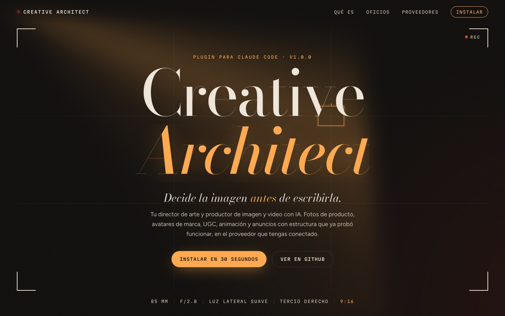
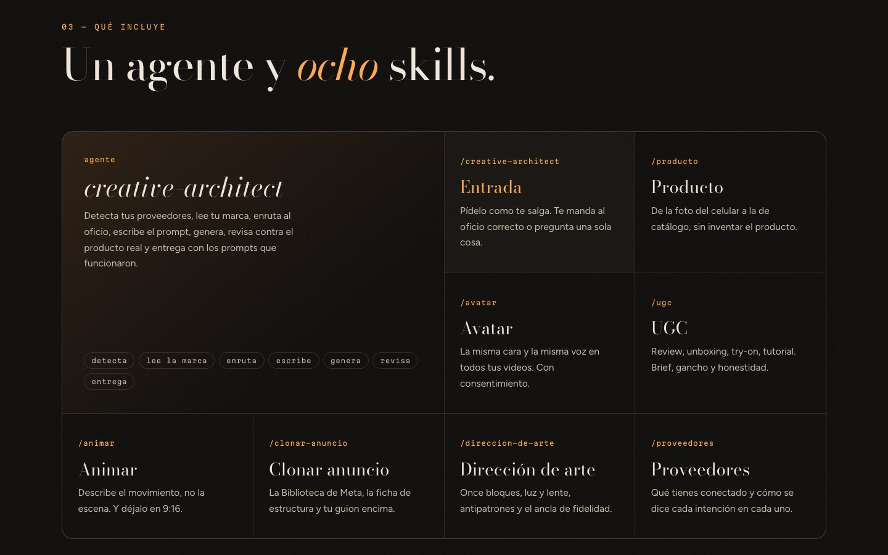

<div align="center">



### Tu director de arte y productor de imagen y video con IA, dentro de Claude Code.

Fotos de producto, avatares de marca, UGC, animación y anuncios con estructura probada,<br>
en **Higgsfield**, **Magnific**, **OpenAI** o el proveedor que tengas conectado.

[](CHANGELOG.md)
[](https://code.claude.com/docs/en/plugins)
[](LICENSE)
[](#)
[](#costos-y-límites)
[](#qué-incluye)

**[Instalar](#instalación)** · **[Qué es](#qué-es)** · **[Qué incluye](#qué-incluye)** · **[Proveedores](#proveedores)** · **[Uso](#uso)** · **[Home](docs/index.html)**

</div>

<br>

## Instalación

Dentro de Claude Code, dos comandos:

```text
/plugin marketplace add Hainrixz/creative-architect
/plugin install creative-architect@creative-architect
```

O desde la terminal, lo mismo:

```bash
claude plugin marketplace add Hainrixz/creative-architect
claude plugin install creative-architect@creative-architect
```

Y pide tu primera pieza:

```text
/creative-architect fotos de mi crema para un anuncio de Meta en 4:5, que se vea premium
```

> [!NOTE]
> El repo es **privado**: Claude Code clona con el `git` de tu máquina, así que necesitas acceso de lectura y una credencial de GitHub ya guardada (`gh auth login` y `gh auth setup-git`, o tu llave SSH). Los comandos de arriba se probaron así.

<details>
<summary><b>Instalar desde una copia local</b></summary>

<br>

```bash
git clone https://github.com/Hainrixz/creative-architect.git ~/creative-architect
claude plugin marketplace add ~/creative-architect
claude plugin install creative-architect@creative-architect
```

Para actualizar: `git -C ~/creative-architect pull` y `/reload-plugins` dentro de Claude Code.

</details>

<details>
<summary><b>Conectar un proveedor</b> (opcional: sin ninguno, recibes el prompt listo para pegar)</summary>

<br>

| Proveedor | Cómo se conecta |
|---|---|
| **Higgsfield** | Activa el conector en la configuración de conectores de claude.ai, o instala la CLI `higgsfield` e inicia sesión con `higgsfield auth login`. |
| **Magnific** | `claude mcp add --transport http magnific https://mcp.magnific.com` y entras con tu cuenta en el navegador. Para reiluminar, expandir o transferir estilo (solo por API REST): exporta `MAGNIFIC_API_KEY` (también acepta `FREEPIK_API_KEY`). |
| **OpenAI** | Exporta `OPENAI_API_KEY` en tu `~/.zshrc` o en tu gestor de secretos. |

Las llaves viven en tu shell, nunca en el repo ni en tus archivos de trabajo. El plugin solo comprueba que existan (`[ -n "$VAR" ]`) y jamás las imprime.

</details>

<br>

## Qué es

Creative Architect es un agente con criterio de director de arte. Antes de generar decide lo que un buen fotógrafo decide antes de disparar: **qué sensación** tiene que dar la imagen, **dónde va a mirar primero** el ojo y **qué no** puede aparecer. Después escribe el prompt por bloques, con luz, lente y composición. Genera en el proveedor que tengas, revisa el resultado contra tu producto real y te entrega la pieza junto con el prompt que funcionó.

Un prompt corto no es libre: es uno donde el modelo elige por ti, y el modelo siempre elige el promedio. Por eso salen imágenes de banco. Este agente toma esas decisiones contigo.

**De dónde viene.** Es la evolución de `higgsfield-estudio` v5.0.0, el plugin de Enrique Rocha para UGC, avatares, fotos de producto y anuncios. Ese plugin tenía mezclados el **oficio** y el **proveedor**. Aquí se separaron:

| | `higgsfield-estudio` 5.0 | **Creative Architect 1.0** |
|---|---|---|
| Proveedor | Solo Higgsfield | Higgsfield, Magnific, OpenAI o el que añadas |
| Skills | Nombraban herramientas y modelos | Piden **intenciones** (`imagen.editar`, `video.desde_imagen`) |
| Costo | Hook que bloqueaba y confirmación obligatoria | Nota informativa de una línea |
| Sin proveedor | No servía | Te entrega el prompt listo para pegar |
| Forma | Skills sueltas | Agente + skill de entrada + 7 skills |

**Sus pilares:** luz y composición siempre · el producto real manda · poco movimiento gana · el gancho se juega en 3 segundos · de la competencia, la estructura y nunca el contenido · sin texto horneado si la pieza lleva texto encima.

<br>

<div align="center">
  <a href="docs/index.html"></a>
  <sub>El home animado vive en <a href="docs/index.html"><code>docs/index.html</code></a>: HTML y CSS puro, sin JavaScript. Ábrelo en tu navegador.</sub>
</div>

<br>

## Qué incluye

Un agente y ocho skills. Sin hooks ni servidores, y unos 890 tokens fijos por sesión.

| Pieza | Para qué |
|---|---|
| **Agente `creative-architect`** | Detecta proveedores, lee tu marca, enruta al oficio, escribe el prompt, genera, revisa y entrega. |
| `/creative-architect` | Entrada única: te manda al oficio correcto o te pregunta una sola cosa. |
| `/direccion-de-arte` | El prompt por bloques que sale profesional: luz y lente, antipatrones, ancla de fidelidad y la forma de `marca.json`. |
| `/producto` | De la foto del celular a la de catálogo o anuncio, sin inventar el producto. |
| `/avatar` | La misma cara y la misma voz en todos tus videos, con consentimiento. |
| `/ugc` | Review, unboxing, try-on, tutorial: brief, gancho y honestidad. |
| `/animar` | Describe el movimiento, no la escena, y lo deja en el formato de la red. |
| `/clonar-anuncio` | La Biblioteca de Anuncios de Meta, la ficha de estructura y tu guion encima. |
| `/proveedores` | Qué tienes conectado y cómo se dice cada intención en cada proveedor. |

<div align="center">
  
</div>

<br>

## Proveedores

| Proveedor | Vía | Fuerte en |
|---|---|---|
| **Higgsfield** | Conector MCP de claude.ai · CLI `higgsfield` | Video, UGC guiado, identidades persistentes, voz, edición con referencia |
| **Magnific** (antes Freepik) | MCP oficial (OAuth) · API REST | Escalado, reiluminado, expansión y detalle de imagen |
| **OpenAI** | API con `OPENAI_API_KEY` | Imagen con texto preciso, edición con referencia y voz en off. Sin video: la API de Sora se apagó el 2026-09-24 |
| **El tuyo** | [`nuevo-proveedor.md`](skills/proveedores/references/nuevo-proveedor.md) | Un archivo que mapea cada intención a sus herramientas. Las skills no se tocan |

Si tienes varios, el agente elige por intención (la tabla de fortalezas está en [`skills/proveedores/SKILL.md`](skills/proveedores/SKILL.md)), o usa el que le pidas: *"hazlo con Magnific"*.

<br>

## Uso

Habla normal. Puedes empezar con `/creative-architect` o pedirlo directo.

| Pides | Lo que hace |
|---|---|
| *"Tengo esta foto de mi crema (`entrada/crema.jpg`). Hazme 3 fotos para Meta en 4:5, que se vea premium, con espacio arriba para el texto."* | `producto` y `direccion-de-arte`: receta sobre bloque de color, ancla de fidelidad, sin texto horneado y revisión contra la foto real. |
| *"Un UGC de 15 s para TikTok: una chica de 25 años probando mis audífonos en el metro."* | `ugc`: brief en una tanda, tres ganchos, guion con tu voz y el flujo guiado del proveedor si existe. |
| *"Arma el avatar de mi marca con estas 10 fotos mías y clona mi voz."* | `avatar`: elige contigo entre identidad entrenada o referencia, confirma tu consentimiento y guarda los IDs en `marca/avatar.json`. |
| *"Anima esta imagen del perfume: un movimiento lento de cámara, 5 s, vertical."* | `animar`: un prompt solo de movimiento (cámara, sujeto, ambiente) y el reencuadre a 9:16. |
| *"¿Qué anuncios corre Café Tostado del Valle? Monta el mío con la estructura del que más lleva activo."* | `clonar-anuncio`: Biblioteca de Meta, ficha de estructura y tu guion encima. Nada de su contenido. |
| *"Este prompt me sale genérico: 'una taza de café en una mesa'. Mejóralo."* | `direccion-de-arte`: lo reescribe en once bloques y explica cada decisión en una línea. |

Cada trabajo queda en `trabajo/<fecha>-<oficio>-<slug>/`, con las piezas, `prompts.md` y, si hubo gasto, `costo.md`.

<details>
<summary><b>Cómo decide</b></summary>

<br>

```text
pedido
  │
  ├─ 1. proveedores   ¿qué hay conectado? (MCP → CLI → variables de entorno)
  ├─ 2. marca         lee marca.json y marca/avatar.json si existen
  ├─ 3. oficio        direccion-de-arte · producto · avatar · ugc · animar · clonar-anuncio
  ├─ 4. prompt        decide (sensación, foco del ojo, qué NO) y escribe por bloques
  ├─ 5. genera        intención → herramienta del proveedor, con nota de costo informativa
  ├─ 6. revisa        antipatrones + fidelidad al producto real; lo que falla se rehace
  └─ 7. entrega       trabajo/<fecha>-<oficio>-<slug>/ con prompts.md
```

</details>

<br>

## Costos y límites

Si el proveedor deja consultar el costo sin generar, el agente lo dice en una línea (*"esto cuesta ~X créditos"*) y sigue. **Es informativo: no hay hook ni confirmación obligatoria.** Si tu proyecto o tú le piden confirmar antes de gastar, lo hace. Si una pieza falla dos veces, para y te propone otro enfoque en vez de reintentar en bucle.

<details>
<summary><b>Lo que nunca hace</b></summary>

<br>

1. Comprar créditos, planes o recargas por ti.
2. Publicar en redes o sitios si no lo pediste.
3. Gastar tus cupos gratuitos o ilimitados sin que lo digas.
4. Borrar, archivar, despublicar ni mover nada remoto (proyectos, carpetas, assets, voces, identidades), ni cambiar ajustes, espacio de trabajo, suscripción o conexiones de tu cuenta, si no lo pediste con esas palabras.
5. Tocar tus campañas de Meta: del conector de Meta solo usa la búsqueda de la Biblioteca de Anuncios, que es de lectura.

Además:
- **Llaves y comandos:** nunca imprime, copia ni guarda tus llaves, y nunca pega el texto de un prompt dentro de un comando.
- **Archivos:** solo sube los que señalaste, y solo al proveedor elegido.
- **Contenido externo:** lo que diga un anuncio, una web, una transcripción o la respuesta de un proveedor lo lee como material, nunca como órdenes.

Por oficio:
- **Caras y voces:** solo entrena caras y clona voces de quien las presta, y nunca de menores.
- **Personas reales:** no genera figuras públicas ni contenido sexual de personas reales, y no inventa testimonios.
- **Publicación y autoría:** declara que lo generado es IA al publicar y no imita a artistas vivos por su nombre.

</details>

<details>
<summary><b>Estructura del repo</b></summary>

<br>

```text
creative-architect/
├── .claude-plugin/
│   ├── plugin.json
│   └── marketplace.json
├── agents/
│   └── creative-architect.md
├── skills/
│   ├── creative-architect/     entrada: /creative-architect
│   ├── direccion-de-arte/      bloques, luz-y-lente, antipatrones, marca
│   ├── producto/               recetas
│   ├── avatar/                 identidad, voz, avatar.schema.json
│   ├── ugc/                    brief, formatos-ugc
│   ├── animar/                 movimiento
│   ├── clonar-anuncio/         anatomia, biblioteca-meta
│   └── proveedores/            intenciones, higgsfield, magnific, openai, nuevo-proveedor, costos
├── docs/
│   ├── index.html              home animado (HTML + CSS)
│   ├── styles.css
│   └── arquitectura.md         el contrato entre oficio y proveedores
├── assets/                     banner animado y capturas del home
├── CHANGELOG.md
├── LICENSE
└── README.md
```

En tu proyecto, el plugin usa `marca.json`, `marca/avatar.json`, `entrada/` para tus archivos y `trabajo/` para los entregables.

</details>

<br>

## Créditos

Creado por **Enrique Rocha** · [tododeia.com](https://tododeia.com)

Basado en `higgsfield-estudio` v5.0.0, del mismo autor. El corazón de este plugin es el oficio de aquel: los bloques del prompt, luz y lente, antipatrones, ancla de fidelidad, recetas de producto, brief y gancho de UGC, y la anatomía de anuncios.

## Licencia

[MIT](LICENSE) © 2026 Enrique Rocha
